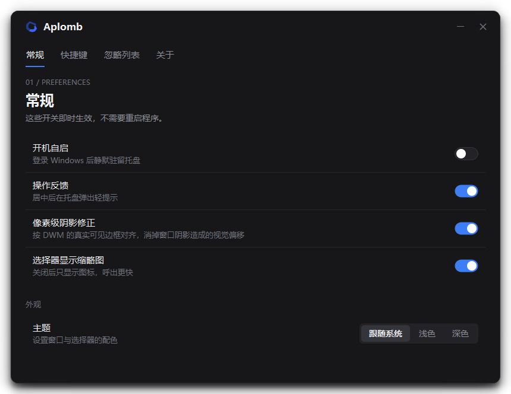
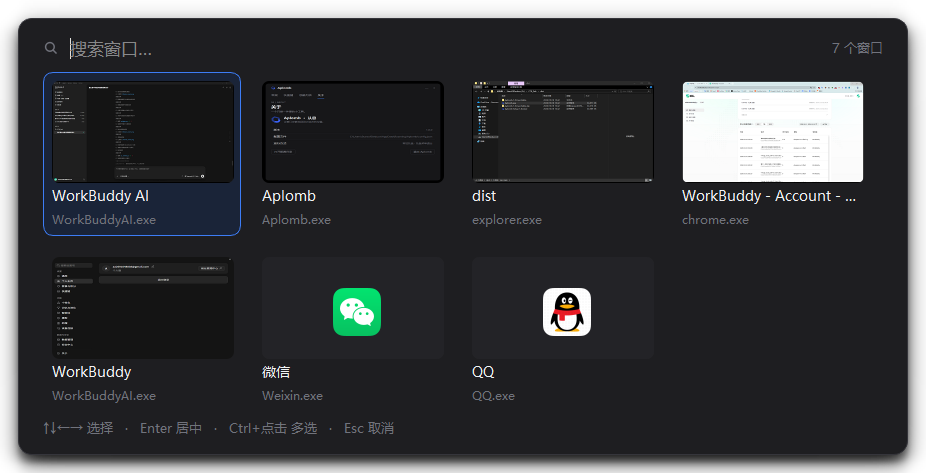
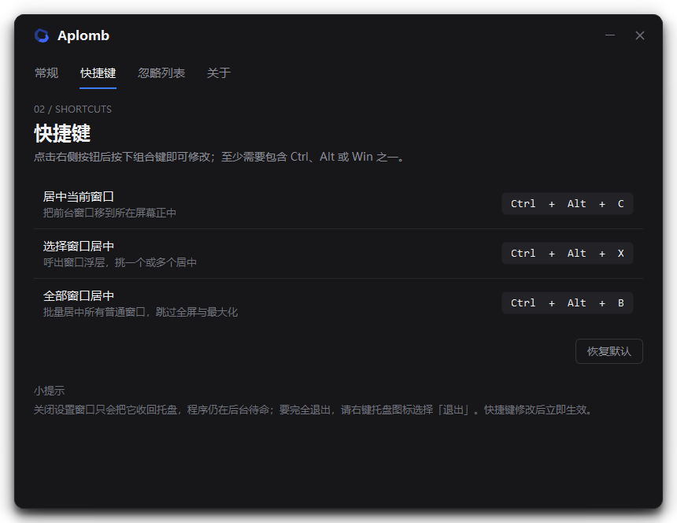
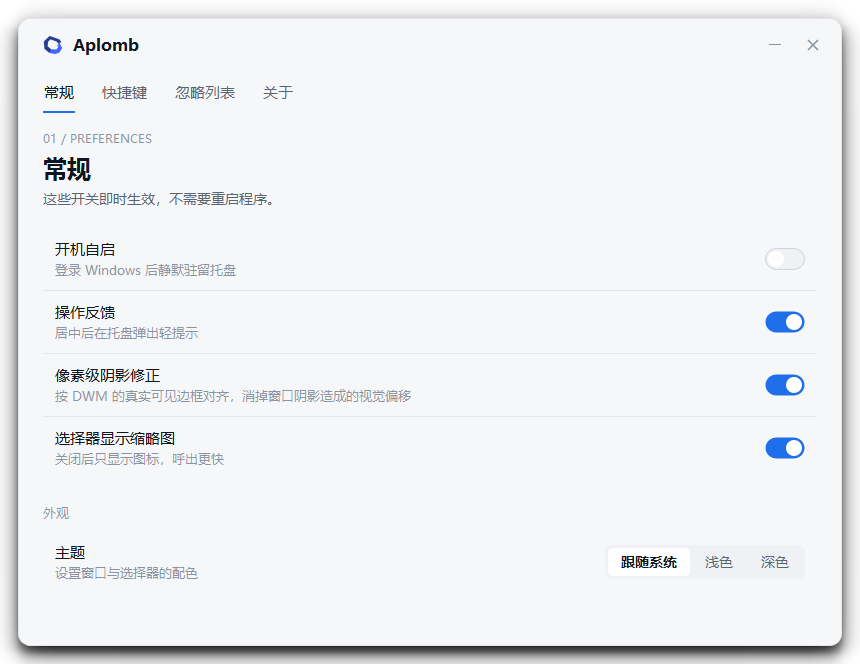
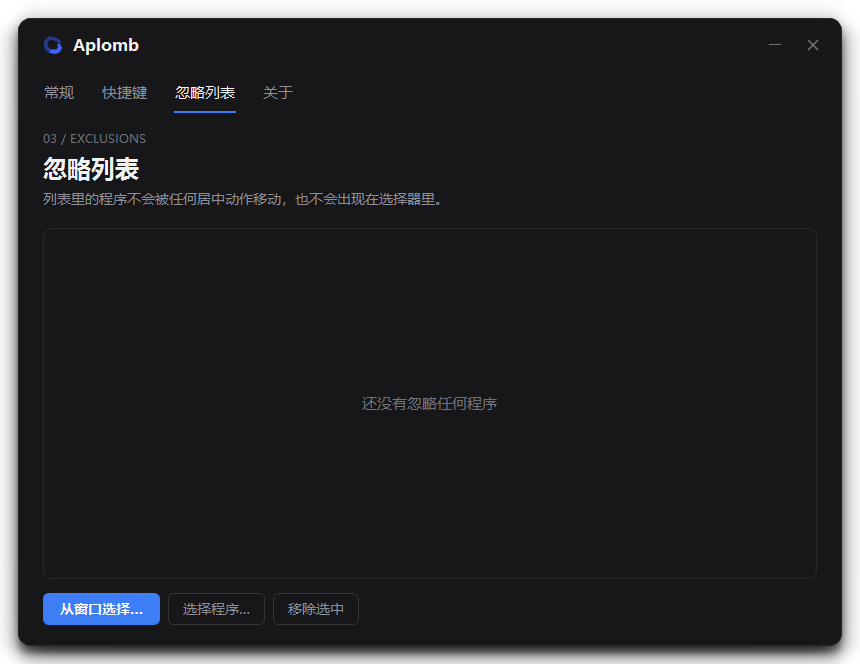
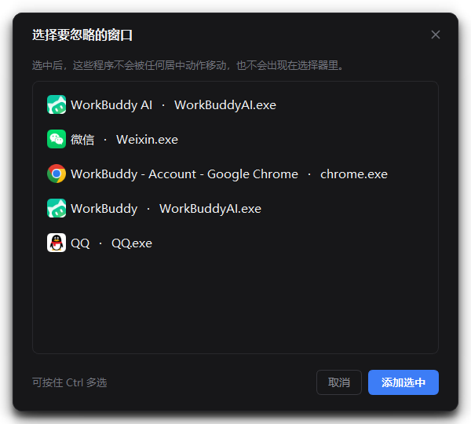

<p align="center">
  
</p>

<h1 align="center">Aplomb · 从容</h1>

<p align="center">
  <b>极简的 Windows 窗口居中工具</b><br>
  <sub>三个全局快捷键 · 像素级对齐 · 缩略图选择器 · 常驻托盘</sub>
</p>

<p align="center">
  
  
  
  
</p>

---

## 📖 简介

**Aplomb** 是法语里的「沉稳自若」，也是建筑学里的「铅垂对中」——名字取的就是这个意思：不喧哗，只把东西摆正。

它常驻系统托盘，用三个全局快捷键把窗口摆回屏幕正中。没有轮询、没有定时器，空闲时几乎不占资源。支持缩略图选择器批量整理、忽略列表、深浅主题，安装包不弹 UAC。



---

## 🎯 为什么值得单独做一个

「把窗口摆到屏幕中间」听起来是件小事，但 Windows 自己做得并不准。

`GetWindowRect` 返回的矩形**包含 DWM 绘制的不可见阴影**，照着它居中，视觉上会偏左偏上几个像素。Aplomb 用 `DWMWA_EXTENDED_FRAME_BOUNDS` 取真实可见边框来对齐，再把阴影偏移补回去——实测误差 **0 像素**。

设置里可以关掉这个修正，对比一下就知道差别。

---

## ✨ 核心特性

### ⌨️ 三个动作，够用就好

居中当前窗口、选择窗口居中、全部窗口居中。默认键位避开了微信 / QQ 的 `Ctrl+Alt+A`（截图）等常见占用，全部可在设置里改，改完立即生效。

### 🖼️ 缩略图选择器

`Ctrl + Alt + X` 呼出 Alt-Tab 式浮层，按标题或进程名实时过滤，方向键移动、Enter 居中、`Ctrl + 点击` 多选。缩略图边出边补，浮层先出现，不卡界面。

### 🎯 像素级居中

按 DWM 可见边框对齐，不是按含阴影的窗口矩形；多显示器下按窗口所在的那块屏幕居中，重复按不会漂移。

### 🙈 自动避让

全屏窗口（游戏、视频、演示）、最大化窗口、系统外壳窗口、忽略列表里的程序，以及**已经卡死不响应的窗口**都会被跳过——后者连标题都不读，避免把界面一起拖住。

### 🗂️ 忽略列表

可以从**正在运行的窗口里直接勾选**，不用翻程序路径；也可以手动指定 exe。

### 🎨 深色 / 浅色 / 跟随系统

纯平色块 + 1px 细线 + 圆角，没有渐变、没有毛玻璃。强调色与图标同一套蓝。

### 🪶 极低开销

托盘待机约 51 MB，选择器展开约 80 MB，连续开关 14 次不增长。不轮询窗口列表，一切由热键消息驱动。

---

## ⌨️ 快捷键

| 快捷键 | 动作 |
| :--- | :--- |
| `Ctrl + Alt + C` | 居中当前窗口 |
| `Ctrl + Alt + X` | 弹出选择器，挑一个或多个 |
| `Ctrl + Alt + B` | 全部窗口居中 |

### 选择器怎么用

- **直接打字** 过滤（按窗口标题或进程名）
- **方向键** 移动，**Enter** 居中，**Esc** 取消并退回原来的窗口
- **Ctrl + 点击** 多选，一次把好几个窗口摆正



---

## 📦 安装

### 安装版

从 [Releases](../../releases) 下载 `Aplomb-Setup-1.0.0.exe`：

- 装到 `%LOCALAPPDATA%\Programs\Aplomb`，**不弹 UAC**，不需要管理员权限
- 可选：桌面快捷方式、开机自动启动
- 开始菜单里有程序和卸载入口，控制面板里也能正常卸载
- 卸载不会删除配置（`%APPDATA%\Aplomb`），重装后设置还在

### 便携版

下载 `Aplomb-1.0.0-portable.zip`，解压后双击 `Aplomb.exe` 即可。

配置写在同目录的 `data\` 里；删掉 `portable.txt` 就改回把配置存到 `%APPDATA%\Aplomb`。放在 U 盘里也能带着走。

### 从源码运行

```bash
git clone https://github.com/<your-name>/Aplomb.git
cd Aplomb
pip install -r requirements.txt
python main.py
```

需要 Python 3.10+ 和 Windows 10 / 11。

---

## ⚙️ 配置

安装版：`%APPDATA%\Aplomb\config.json`
便携版：`<exe 所在目录>\data\config.json`

```json
{
  "hotkey_center_current": "Ctrl+Alt+C",
  "hotkey_center_select": "Ctrl+Alt+X",
  "hotkey_center_all": "Ctrl+Alt+B",
  "autostart": false,
  "show_notifications": true,
  "pixel_perfect": true,
  "theme": "system",
  "picker_thumbnails": true,
  "ignore_list": []
}
```

---

## 🔧 自己打包

```bash
pip install -r requirements-dev.txt
python build.py            # exe + 便携包 + 安装包
python build.py exe        # 只打 exe
python build.py portable   # 只做便携包
python build.py setup      # 只做安装包
```

产物在 `dist/`。

安装包用 [NSIS](https://nsis.sourceforge.io/) 构建。把 NSIS 解压到 `.tools/nsis/`（该目录已在 `.gitignore` 里），或用环境变量指定：

```bash
NSIS_MAKENSIS="C:/Program Files (x86)/NSIS/makensis.exe" python build.py setup
```

---

## 🖼️ 界面预览

| 快捷键设置 | 浅色主题 |
| :--- | :--- |
|  |  |

| 忽略列表 | 从窗口选择 |
| :--- | :--- |
|  |  |

---

## 📁 项目结构

```text
Aplomb/
├── app/
│   ├── win32api.py          # ctypes 绑定：结构体、函数原型、安全包装
│   ├── windows.py           # 窗口枚举、过滤、居中算法
│   ├── hotkeys.py           # RegisterHotKey + 原生事件过滤
│   ├── thumbnails.py        # PrintWindow 抓缩略图（GDI 资源即用即还）
│   ├── icons.py             # 程序图标加载与窗口图标缓存
│   ├── config.py            # JSON 配置，原子写入，便携模式
│   ├── autostart.py         # HKCU Run 键
│   └── ui/
│       ├── theme.py         # 两套配色 + 样式表
│       ├── widgets.py       # 开关、快捷键录制、分段控件、标题栏按钮
│       ├── settings_window.py
│       ├── window_chooser.py # 从当前窗口里挑要忽略的程序
│       ├── picker.py        # 缩略图浮层
│       └── tray.py
├── installer/
│   ├── Aplomb.nsi           # NSIS 安装脚本
│   ├── welcome.bmp          # 欢迎页图（生成）
│   └── header.bmp           # 页眉图（生成）
├── design/                  # 图标设计源图
├── assets/                  # 运行时素材：aplomb.ico / aplomb.png
├── tools/                   # 开发自检与打包辅助
├── screenshots/
├── main.py
├── build.py
├── requirements.txt         # 运行依赖
└── requirements-dev.txt     # 打包 / 生成图标依赖
```

---

## 🧠 实现细节

几个不那么显然、但决定成败的地方：

**居中要现取几何。** 用缓存的窗口矩形算阴影偏移，连续按两次快捷键会跳回原位。每次都必须重新 `GetWindowRect`。

**读窗口标题绝不能阻塞。** `GetWindowText` 对别的进程是同步 `SendMessage`，目标程序一旦卡住，调用方会跟着挂死。这里统一用带 50 ms 超时的 `SendMessageTimeout`，并且先判 `IsHungAppWindow` 再读标题。

**热键消息会重复投递。** Qt 的原生事件过滤器会把同一次 `WM_HOTKEY` 送来多次，只处理 `windows_generic_MSG` 并按 `(wParam, time)` 去重，否则浮层刚开就被自己关掉。

**不要给控件指定字体。** 在样式表里写 `font-family` 或调用 `app.setFont()`，会让 Qt 为每个控件单独解析字体回退链，实测多占 50 MB 以上。字号靠 `font-size` 控制就够了。

**别用默认字体里没有的符号。** `✕`(U+2715)、`⋯`(U+22EF) 这类字形会触发整套符号字体回退加载，单个字形能多占 56 MB。需要图标就自己画。

**`deleteLater()` 不会立刻执行。** 关闭选择器时要显式投递 `DeferredDelete`，否则每开关一次泄漏约 0.5 MB。

实测内存（1080p，7 个窗口）：

| 状态 | 内存 |
| :--- | :--- |
| 纯 PySide6 托盘基线 | 46.8 MB |
| 常驻托盘（设置窗口关着） | 50.9 MB |
| 设置窗口打开 | ~70 MB |
| 选择器展开（带缩略图） | ~80 MB |
| 连续开关 14 次 | 76.7 MB，**不再增长** |

---

## 🧪 自检

仓库里带了几个可以直接跑的检查脚本（开发时用，不会打进 exe）：

```bash
python tools/selftest.py    # 居中精度、热键注册、自身窗口处理
python tools/ui_smoke.py    # 界面交互：翻页、开关、快捷键、选择器键盘流
python tools/e2e.py         # 起真进程，走一遍热键 → 浮层 → 居中，并截图
python tools/hang_probe.py  # 启动耗时与 UI 线程响应性
```

---

## ⚠️ 已知限制

- 只支持 Windows 10 / 11
- 全屏独占的游戏窗口不会被移动（这是特性，不是 bug）
- 部分应用（如某些 Electron / 硬件加速窗口）`PrintWindow` 拿不到画面，选择器里显示程序图标作为占位
- 安装版和便携版不要同时运行（单实例互斥，后启动的会去唤起已有实例）
- 深色任务栏下，图标深蓝那一半对比度偏低，16 px 时略糊

---

## 📄 License

[MIT](LICENSE)
